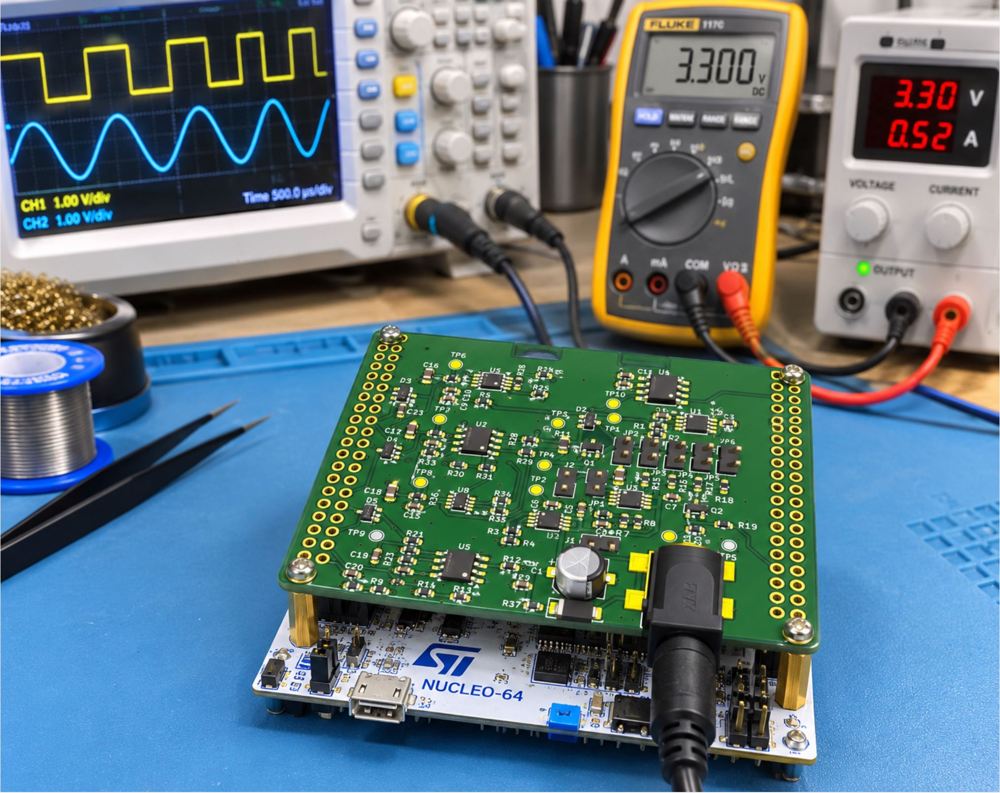
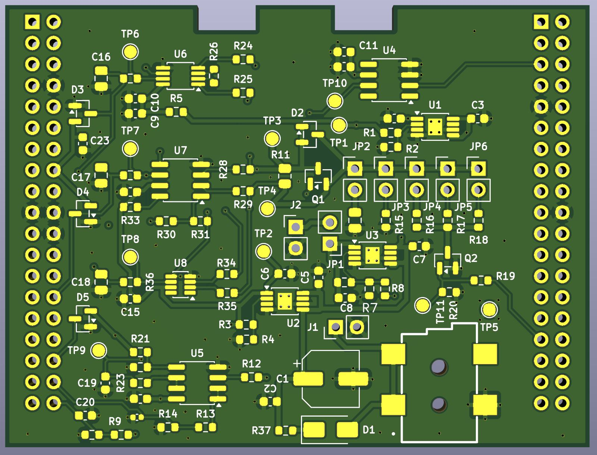
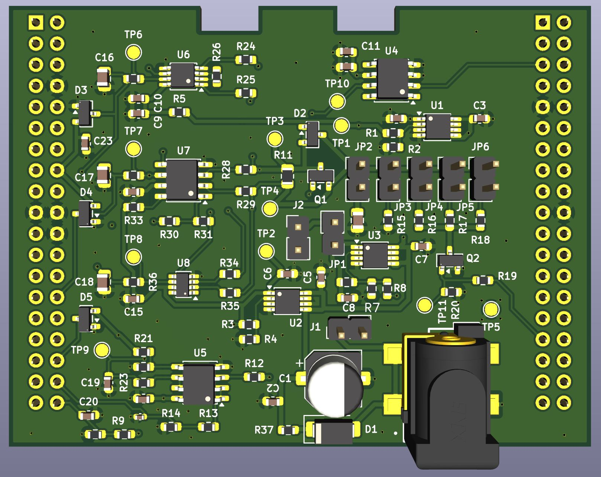

# INA350 Nucleo-64 Hat

Test board that plugs onto an STM32 **NUCLEO-64** through the morpho connectors. It compares three
instrumentation amplifiers measuring the **same current shunt**:

- **TI INA350CDS** (U8)
- **Analog Devices AD8220** (U6)
- **Microchip MCP6N11-010** (U7)

The board reproduces one range of a current-measurement front end (shunt, bypass MOSFET and
protection). The three amplifiers can then be compared on real hardware before choosing one for a
power-measurement module. No oscilloscope is needed: the Nucleo is meant to sample the three outputs
at the same time with its own ADCs, synchronised with a load-step timer, and send the results over USB.



*Concept image, not a photo of an assembled board.*

<a href="https://www.pcbway.com/project/shareproject/INA350_Nucleo_64_Hat_3d76e212.html"></a>

| PCB layout | 3D view |
|---|---|
|  |  |

## Status

**Rev 0.1**: design finished and fabrication files generated. Not yet assembled or tested.
The test firmware is not written yet.

## Features

- Three amplifier channels (rows A, B, C) on one 4.99 kΩ 0.1 % shunt (R11, between VM and VOUT),
  each with its own Kelvin connection to the shunt.
- Shunt bypass MOSFET (Q1, AO3400A) driven by a UCC27524 gate driver (U4), controlled by the Nucleo.
- Loads on VOUT selected with jumpers JP2–JP6, including a step load (Q2 + R16 33 Ω, about 100 mA at
  3.3 V) switched by a timer output.
- Programmable measured voltage VM: adjustable TLV76701 LDO with the Nucleo DAC injected into its
  feedback (about 0.8 V to 5.3 V). Open JP1 to feed an external VM on J2 instead.
- Local rails from 12 V: +10V_G and +5V5_A (TLV76701 LDOs). A TLV9002 buffers the 0.30 V amplifier
  reference and VOUT.
- 12 V input through a DC jack (J5) or a 2-pin header (J1), with an SS34 series diode and a 470 µF bulk
  capacitor.
- Test points on every relevant node and six jumpers to configure the channels.

## Board

- 70 × 53 mm, 4 layers (In1 power, In2 signal), green solder mask.
- 2×19 sockets (HC-PM254-8.5H) on the bottom side; the board sits about 11 mm above the Nucleo.
- Two 3 mm notches on the top edge leave room for the Nucleo user and reset buttons (B1/B2).
- Fine-pitch parts use `_PCBWay` footprint variants (solder-mask web ≥ 0.19 mm between pads).

## Compatible Nucleo boards

| Board | Notes |
|---|---|
| NUCLEO-G474RE (MB1367) | Move **JP8 to [2-3]** so that VREF+ = VDD. With the factory VREF+ of 2.5 V the full output range does not fit. |
| NUCLEO-G564RE (MB2067) | Works as is. The DAC output is on PA5 instead of PA4. |

No solder bridges need to be changed on either board.

## Nucleo pin mapping

| Signal | Morpho pin | MCU pin | Use |
|---|---|---|---|
| O_A, AD8220 output | CN7-30 | PA1 | ADC / COMP1 |
| O_B, MCP6N11-010 output | CN7-28 | PA0 | ADC / COMP3 |
| O_C, INA350 output | CN7-34 | PB0 | ADC / COMP4 |
| DAC_VM, VM setpoint | CN7-32 | PA4 (G474RE) / PA5 (G564RE) | DAC |
| VOUT_S, output voltage sense | CN7-36 | PC1 | ADC |
| VM_S, VM sense | CN7-38 | PC0 | ADC |
| LOAD, load step | CN10-31 | PB3 | TIM2_CH2 |
| BYP0, shunt bypass | CN10-5 | PB9 | GPIO |
| +3V3 | CN7-16 | | |
| GND | CN7-8/19/20/22, CN10-9/20 | | |

## Repository layout

```
kicad/                          KiCad 10 project (schematic, PCB, design rules)
kicad/lib/                      project libraries: symbols, footprints and 3D models used by the board
fabrication/2026-11-17_rev0.1/  Gerbers + drill files (folder and zip), BOM, pick-and-place
images/                         README images
```

Open `kicad/PRUEBA_INA.kicad_pro` with **KiCad 10.0** or newer. The project keeps its original internal
name (`PRUEBA_INA`, Spanish for "INA test"). Part of the schematic text is in Spanish.

## Manufacturing notes

- `PRUEBA_INA_gerbers.zip` is ready to upload to a PCB fab (4 layers, 1.6 mm).
- The BOM lists LCSC part numbers where available. Generic 0603 passives have no part number.
- Test points are pads only and are not in the BOM.

## License

Copyright © 2026 CValdesS.com

This hardware design is licensed under the **CERN Open Hardware Licence Version 2 – Strongly
Reciprocal** (CERN-OHL-S-2.0). See [LICENSE](LICENSE).

Footprints and 3D models in `kicad/lib/easyeda2kicad.*` were converted from the LCSC/EasyEDA library
with [easyeda2kicad](https://github.com/uPesy/easyeda2kicad.py) and are included for convenience.
